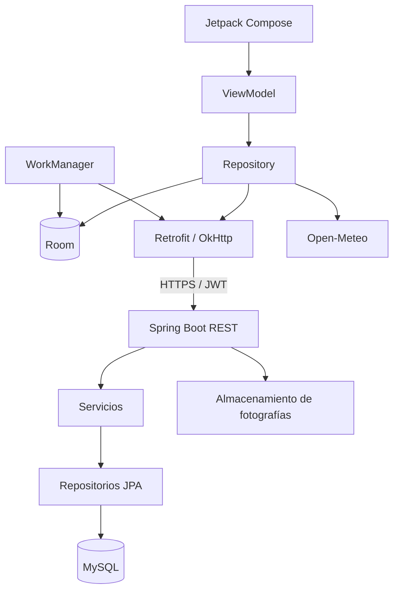

> **Caso académico:** AquaCheck Buceo / AquaChile APP  
> **Asignatura:** Desarrollo de Aplicaciones Móviles  
> **Institución:** Duoc UC Sede Puerto Montt  
> **Socio Formador:** AquaChile  

# AquaCheck — AquaChile APP

**Versión 1.0.0 | Android · Kotlin · Spring Boot · MySQL**

AquaCheck es una aplicación móvil orientada al registro y seguimiento preventivo de las actividades de buceo. Permite gestionar prechequeos, evidencias fotográficas, evaluaciones de seguridad y bitácoras post-inmersión, con soporte para trabajo sin conexión.

El proyecto es un prototipo académico destinado exclusivamente a datos ficticios. Sus evaluaciones no constituyen autorización médica ni operacional para realizar inmersiones.

## Descarga e instalación

[**Descargar AquaCheck v1.0.0 (APK)**](https://github.com/buhduoc/AquaChile-APP/releases/tag/v1.0.0)

1. Abrir la Release y descargar `AquaChile-v1.0.0.apk` desde **Assets**.
2. Abrir el archivo en un dispositivo Android 8.1 (API 27) o superior.
3. Autorizar temporalmente la instalación desde el origen utilizado, si Android lo solicita.
4. Instalar AquaCheck e iniciar sesión con una cuenta de demostración autorizada.

La APK está firmada y versionada (`versionCode = 1`, `versionName = 1.0.0`). No se necesita Android Studio para instalarla.

## Servicios en línea

| Servicio | Acceso |
|---|---|
| Código fuente | [GitHub](https://github.com/buhduoc/AquaChile-APP) |
| Distribución Android | [GitHub Releases](https://github.com/buhduoc/AquaChile-APP/releases) |
| Backend REST | [Railway](https://aquachile-app-production.up.railway.app/) |
| Documentación API | [Swagger UI](https://aquachile-app-production.up.railway.app/swagger-ui/index.html) |

La APK utiliza el backend HTTPS desplegado en Railway. Spring Boot y MySQL funcionan en la nube, independientemente del computador del desarrollador. No es necesario iniciar Laragon ni un servidor local para utilizar esta versión.

La disponibilidad depende de Internet, del estado de los servicios y del crédito o plan de Railway. Los volúmenes persistentes están destinados a conservar los datos de MySQL y las fotografías entre reinicios.

## Funcionalidades

| Módulo | Descripción |
|---|---|
| Autenticación | Inicio de sesión mediante JWT y perfiles de buzo y supervisor. |
| Prechequeo | Formularios de seguridad, salud, equipos y registro de faena. |
| Semáforos | Evaluación preventiva verde, amarilla y roja, con bloqueo de condiciones críticas en la interfaz. |
| Evidencias | Fotografías de equipos y comparación con línea base. |
| Historial | Consulta de registros y gestión según el perfil. |
| Bitácora | Registro post-inmersión de profundidad, tiempo de fondo y velocidades. |
| Meteorología | Consulta de información meteorológica mediante Open-Meteo. |
| Modo offline | Almacenamiento local de prechequeos y evidencias pendientes. |
| Sincronización | Envío de registros pendientes cuando se recupera la conexión. |
| Supervisión | Gestión de cuentas, solicitudes y prechequeos. |

## Arquitectura

La aplicación Android utiliza MVVM (Model–View–ViewModel), separando la interfaz, el estado y la lógica de acceso a datos. El backend utiliza una arquitectura monolítica por capas.



## Tecnologías

| Android | Backend e infraestructura |
|---|---|
| Kotlin, Jetpack Compose, Material 3 | Java 17, Spring Boot |
| ViewModel, Coroutines | Spring Web, Spring Data JPA |
| Retrofit, OkHttp | Spring Security, JWT |
| Room, DataStore, WorkManager | MySQL, Swagger / OpenAPI |
| Coil | Docker, Railway |
| JUnit, MockK, JaCoCo, Compose UI Test | Git, GitHub |

## Modo offline y sincronización

Room permite conservar registros localmente. WorkManager procesa la cola persistente cuando existe conectividad y una sesión válida. La interfaz distingue el modo offline y los registros pendientes de sincronización de los registros sincronizados.

Las evaluaciones locales no representan una aprobación definitiva. El flujo de sincronización utiliza identificadores UUID para reducir duplicados y conserva los registros pendientes cuando se producen errores recuperables. Las fotografías se envían al backend como parte del proceso.

## API externa: Open-Meteo

[Open-Meteo](https://open-meteo.com/) proporciona información meteorológica contextual mediante una API HTTP. La aplicación presenta información del tiempo para apoyar la consulta de condiciones ambientales. Esta información no autoriza inmersiones ni sustituye una evaluación profesional de seguridad.

## API REST

El contrato completo, los esquemas y las operaciones disponibles se encuentran en [Swagger UI](https://aquachile-app-production.up.railway.app/swagger-ui/index.html).

Principales rutas conocidas:

| Método | Ruta | Función |
|---|---|---|
| POST | `/api/auth/login` | Autenticación y obtención del token JWT |
| POST | `/api/usuarios` | Registro de usuario |
| GET | `/api/usuarios` | Listado de usuarios (supervisor) |
| GET | `/api/usuarios/{id}` | Consulta de usuario |
| PUT | `/api/usuarios/{id}` | Actualización de usuario |
| PATCH | `/api/usuarios/{id}/aprobar` | Aprobación de cuenta |
| DELETE | `/api/usuarios/{id}` | Eliminación de usuario |
| GET | `/api/prechequeos` | Consulta de prechequeos |
| POST | `/api/prechequeos` | Creación de prechequeo |
| DELETE | `/api/prechequeos/{id}` | Eliminación por supervisor |
| POST | `/api/fotos` | Carga multipart de fotografía (`archivo`) |
| GET | `/api/fotos/{nombre}` | Recuperación de fotografía |

Las operaciones protegidas requieren el encabezado `Authorization: Bearer <token>`. La API distingue solicitudes sin autenticación (401) de accesos sin permisos suficientes (403). Consultar Swagger para las demás operaciones y sus restricciones.

## Estructura del repositorio

```text
AquaChile-APP/
├── app/
│   ├── src/main/                 # Aplicación Android
│   ├── src/test/                 # Pruebas unitarias
│   ├── src/androidTest/          # Pruebas instrumentadas
│   └── build.gradle.kts
├── AquaCheck-Backend/            # Backend Spring Boot
├── evidencias/                   # Capturas de funcionamiento y pruebas
├── gradlew.bat
└── README.md
```

## Ejecutar desde el código fuente

### Requisitos

- Git y Android Studio con Android SDK 36.
- JDK 17 para Gradle y el backend.
- Emulador o dispositivo Android API 27 o superior.
- MySQL únicamente si se desea ejecutar el backend local.

### Clonar y ejecutar Android

```powershell
git clone https://github.com/buhduoc/AquaChile-APP.git
cd AquaChile-APP
.\gradlew.bat :app:assembleDebug
```

Abrir la raíz del repositorio en Android Studio, sincronizar Gradle, seleccionar el módulo `app` y ejecutar en un dispositivo o emulador. Por defecto se utiliza la URL de Railway configurada en `app/build.gradle.kts`.

### Backend local (opcional)

Iniciar MySQL y crear una base de datos `aquachile`. Configurar las variables de entorno con las credenciales de la instalación local. No publicar sus valores.

```powershell
cd AquaCheck-Backend
$env:AQUA_DB_URL = 'jdbc:mysql://127.0.0.1:3306/aquachile'
$env:AQUA_DB_USER = Read-Host 'Usuario MySQL'
$env:AQUA_DB_PASSWORD = Read-Host 'Clave MySQL'
$bytes = New-Object byte[] 32
$rng = [System.Security.Cryptography.RandomNumberGenerator]::Create()
$rng.GetBytes($bytes)
$env:AQUA_JWT_SECRET = [Convert]::ToBase64String($bytes)
$rng.Dispose()
.\gradlew.bat bootRun
```

Para inicializar cuentas ficticias, configurar antes de arrancar el perfil `demo-local` y las variables `AQUA_BUZO1_CLAVE`, `AQUA_BUZO2_CLAVE` y `AQUA_ADMIN_CLAVE` con claves propias de al menos seis caracteres. Mantener el secreto JWT estable entre reinicios si se desea conservar la validez de las sesiones.

Swagger local: <http://localhost:8080/swagger-ui/index.html>.

Desde la raíz del repositorio, compilar Android contra el backend local del emulador:

```powershell
.\gradlew.bat :app:assembleDebug -PAQUA_API_URL=http://10.0.2.2:8080/
```

La conexión HTTP local requiere que la configuración de seguridad de red de la variante utilizada permita tráfico sin cifrar. En un dispositivo físico, `10.0.2.2` no apunta al computador: utilizar la dirección de red correspondiente y configurar el acceso local. Para distribución se recomienda HTTPS.

## Pruebas automatizadas

Ejecutar desde la raíz del repositorio:

```powershell
# Pruebas unitarias
.\gradlew.bat :app:testDebugUnitTest

# Cobertura de ViewModel y Repository
.\gradlew.bat :app:jacocoDebugReport

# Pruebas instrumentadas (requiere dispositivo o emulador activo)
.\gradlew.bat :app:connectedDebugAndroidTest
```

| Reporte | Ubicación |
|---|---|
| JUnit | `app/build/reports/tests/testDebugUnitTest/index.html` |
| JaCoCo | `app/build/reports/jacoco/jacocoDebugReport/html/index.html` |
| Compose UI | `app/build/reports/androidTests/connected/debug/index.html` |

Las pruebas instrumentadas se ejecutaron en un emulador Android 15. Las capturas de los resultados y de las funcionalidades están disponibles en [`evidencias/`](evidencias/).

## Seguridad y alcance

- Utilizar únicamente cuentas y datos ficticios.
- No publicar secretos JWT, credenciales de base de datos ni claves privadas de firma (`.jks`).
- La aplicación utiliza autenticación JWT y permisos por perfil; no constituye una solución certificada de seguridad operacional ni de gestión de datos médicos reales.
- La disponibilidad de los servicios externos depende de sus respectivos proveedores.

## Equipo de Desarrollo

- **Sección:** 002D
- **Equipo:** Equipo NAM - 6

| Nombre y Apellido | Rol en el Proyecto |
|---|---|
| Nicolas Oyarzo | Desarrollo Móvil |
| Alexander Gutierrez | Desarrollo Móvil |
| Matias Mansilla | Desarrollo Móvil |
