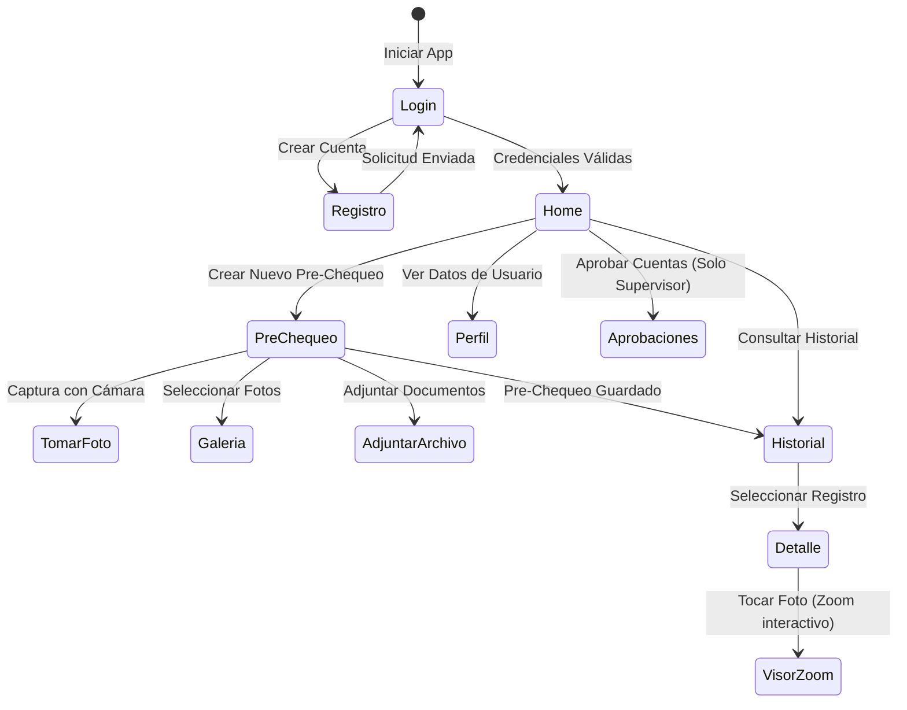

# AquaChile APP - Pre-Chequeo de Seguridad en Operaciones de Buceo

> **Caso académico:** AquaCheck Buceo / AquaChile APP  
> **Asignatura:** Desarrollo de Aplicaciones Móviles  
> **Institución:** Duoc UC Sede Puerto Montt  
> **Socio Formador:** AquaChile  

---

## Nombre y Propósito del Proyecto

**AquaChile APP** es una solución móvil nativa en Android diseñada para digitalizar y optimizar el proceso de **pre-chequeo de seguridad previo a las faenas de buceo profesional** en los centros de engorda de salmones de AquaChile.

### Problema que resuelve
Tradicionalmente, la revisión de equipos de buceo y las verificaciones preventivas de salud se registran manualmente en papel o bitácoras físicas. Esto dificulta la trazabilidad inmediata, incrementa el riesgo de pérdida de información y limita la capacidad de auditar la seguridad antes de cada inmersión.

### Solución propuesta
La aplicación ofrece un flujo guiado e intuitivo en terreno que abarca:
* **Autenticación y Roles**: Acceso diferenciado para Buzos y Supervisores con flujo de registro y aprobación de cuentas.
* **Registro de Faena**: Captura de datos del centro de operación, fecha/hora, buzo y supervisor a cargo.
* **Checklist Operativo de Seguridad**: Evaluación ítem por ítem (*OK / Cumple*, *Obs. / Observado*, *No / No cumple*, *N/A*) con insignias de prioridad (*Crítico*), validación de observaciones obligatorias y barra de progreso en tiempo real.
* **Evidencias Multimedia**:
  - Captura directa de fotografías con la cámara del dispositivo (`FileProvider`).
  - Selección de imágenes desde la galería (`PickMultipleVisualMedia`).
  - Adjuntado de archivos y documentos generales (PDFs, documentos corporativos).
  - Eliminación individual de evidencias y visor interactivo a pantalla completa con **Pinch-to-Zoom (hasta 5x)** y desplazamiento.
* **Evaluación de Salud del Buzo**: Monitoreo de presión arterial (sistólica/diastólica), saturación de O₂ (%) y cuestionario preventivo con alertas visuales de estado físico.
* **Historial y Búsqueda Avanzada**: Filtro por resultado (*Cumple, Observado, Requiere revisión*), búsqueda por texto y vista detallada del registro.

---

## Identidad Visual y Diseño

### Logotipo
* **Ubicación:** `docs/diseno/AquaChileAPP_LOGO.png` / `res/drawable/aquachile_logo.png`
* **Aplicación:** Icono oficial de la app y pantalla de inicio de sesión integrada en una tarjeta estilizada sobre fondo azul corporativo.

### Paleta de Colores

| Elemento | Código HEX | Uso dentro de la App |
| :--- | :--- | :--- |
| **Morado Corporativo** | `#3A3399` | Encabezados de pantalla, botones principales y barra superior. |
| **Morado Oscuro** | `#2D2880` | Degradados de inicio de sesión y menús laterales. |
| **Fondo General** | `#F3F5FF` | Fondo limpio para máxima legibilidad en dispositivos en terreno. |
| **Estado OK / Cumple** | `#10B981` | Tarjetas e insignias de ítems conformes. |
| **Estado Observado** | `#D97706` | Alertas de ítems observados y observaciones pendientes. |
| **Estado Crítico / No Cumple** | `#EF4444` | Insignias críticas, errores de validación y alertas de salud. |

---

## Diagrama de Flujo de Usuario



---

## Pantallas y Componentes Principales

| Componente / Pantalla | Archivo | Funcionalidad |
| :--- | :--- | :--- |
| **Inicio de Sesión** | `LoginScreen.kt` | Formulario en tarjeta blanca sobre fondo azul con logo corporativo centrado. |
| **Menú Principal** | `HomeScreen.kt` | Resumen de actividad, accesos directos e indicadores del usuario. |
| **Nuevo Pre-Chequeo** | `PreChequeoScreen.kt` | Formulario completo: datos de faena, checklist operativo, evidencias y salud. |
| **Checklist Operativo** | `FilaChecklist.kt` | Tarjetas por ítem con insignias de *Crítico*, botones *Cámara* / *Galería* y observaciones. |
| **Visor de Evidencias** | `Fotos.kt` | Galería horizontal con eliminación y modal de zoom interactivo (*pinch-to-zoom* y pan). |
| **Historial de Pre-Chequeos**| `HistorialScreen.kt` | Buscador multi-criterio y filtros por resultado de seguridad. |
| **Detalle de Pre-Chequeo** | `DetalleScreen.kt` | Vista completa del registro con inspección de fotos ampliables y documentos adjuntos. |
| **Aprobación de Cuentas** | `AprobacionesScreen.kt` | Módulo de supervisión para habilitar nuevos usuarios. |

---

## Tecnologías y Librerías

* **Lenguaje:** Kotlin 2.0
* **Framework UI:** Jetpack Compose (BOM 2024.09.00)
* **Sistema de Diseño:** Material Design 3 (`androidx.compose.material3`)
* **Navegación:** Navigation Compose (`2.8.8`)
* **Gestión de Estado:** ViewModel (`2.8.7`) + StateFlow / SnapshotStateList
* **Carga de Imágenes:** Coil Compose (`2.7.0`)
* **Cámara y Galería:** Android Activity Result Contracts + FileProvider (`androidx.core.content.FileProvider`)

---

## Compilación y Ejecución

1. Requisitos: **Android Studio Ladybug (o superior)** con Android SDK 36.
2. Clonar el repositorio y abrir en Android Studio.
3. Sincronizar las dependencias con Gradle.
4. Compilar y ejecutar en emulador o dispositivo físico (Android 8.1 / API 27+):
```bash
./gradlew :app:assembleDebug
```

---

## Equipo de Desarrollo

* **Sección:** 002D
* **Equipo:** Equipo NAM - 6

| Nombre y Apellido | Rol en el Proyecto |
| :--- | :--- |
| **Nicolas Oyarzo** | Desarrollo Móvil |
| **Alexander Gutierrez** | Desarrollo Móvil |
| **Matias Mansilla** | Desarrollo Móvil |

---
